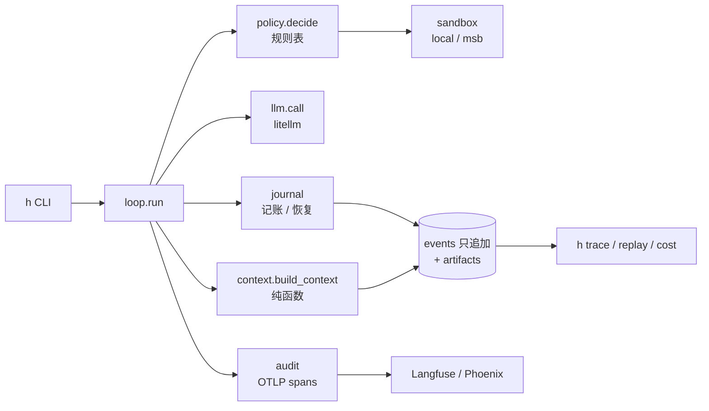

# harness 一页说明

## 一句话

单机、单进程的本地 coding agent 执行层：模型负责写代码，这一层负责让它的每一步**可审计、可恢复、可回放、副作用可控**。

## 它解决什么问题

把「LLM 改代码」当成一个长跑任务，会遇到五个工程问题：

| 问题 | 常见做法 | 这里的做法 |
|---|---|---|
| 上下文越跑越大 | 全塞 / 粗暴截断 | S0–S5 分层预算装填，超预算丢最旧一组；压缩保留任务状态 |
| 同一文件反复读 | 每次都读 | read 缓存，返回 `[unchanged since seq N]`；resume 后从事件重建 |
| 进程崩了状态不明 | 重试或放弃 | 事件溯源 + 写操作 sha 三态判定：已写入不重跑、未写入安全重跑、状态未知显式报错 |
| 副作用不可控 | 在 prompt 里请求 | 有序策略规则表 + diff 审批 + 沙箱 + `finish` 证据门槛 |
| 出错后无法复盘 | 看文本日志 | 追加事件 + 内容寻址 artifact + `replay` 逐字节比对 + OTLP 导出 |

## 架构

一次工具调用的顺序是固定的：**先记 `tool.call`（含 sha_before/after）→ 策略决策落库 → 执行 → 记 `tool.result`**。所以崩溃发生在任何位置，恢复时都能判定「做没做过」。

## 关键机制

1. **事件溯源**：`events` 只追加，DB 触发器拒绝 UPDATE/DELETE；读模型全部从事件推导。
2. **纯函数上下文**：`build_context(events, cfg, snapshot)` 只依赖事件与配置，同一输入必得同一请求；`replay` 用它比对历史请求。
3. **三态恢复**：写类调用记录目标路径与前后 hash；恢复时文件等于 after → 已执行，等于 before → 未执行，否则报 unknown。
4. **策略门控**：规则按顺序首个命中；`deny/ask/allow` 本身是事件，`always` 从事件恢复；读也默认限制在 workspace 内。
5. **证据门槛**：改过文件后，最后一次编辑之后必须有一次成功 `bash`（或 feature list 全绿）才允许 `finish`。
6. **收尾提示**：最后一次编辑后的第一次成功验证，工具结果里直接提示 `finish`——解决「代码对了但不交卷」。

## 数据（deepseek-chat，2026-11-06）

| 维度 | 结果 |
|---|---|
| 测试 | 166 个，mypy 26 文件零问题，ruff 全绿，Windows + Ubuntu CI（含评测基线自检） |
| 评测 | 9 个任务：4 玩具 + 5 仓库级；仓库级 5/5 |
| 成本 | 玩具任务 $0.0005/个；真实仓库任务 $0.002–0.016/个 |
| 观测 | OTLP → 本地 Langfuse：`turn → tool` 父子树、session 归组、usage 正确 |

## 取舍与反例（都写在这，不粉饰）

- **压缩省 token 不省钱**：4k 窗口下 tokens −14%，成本 +73%（摘要调用要花钱）
- **read 缓存有前提**：单任务关缓存 +19.8% tokens；任务集里每个文件只读一次时无差异
- **大任务要按规模给预算**：60 步预算下 `edit_lines` 54 步通过；45 步会被截断
- **隔离是进程级**：sandbox 不是容器/VM，`microsandbox` 路径未在真 WHP 环境验证

## 非目标

Web UI、多 agent 编排、向量记忆、插件系统、多租户服务化。做了会稀释「1500 行可读完、单机可跑通」的定位。

## 文件

- 入口：`README.md`
- 每次修改：`docs/CHANGELOG.md`
- 欠债与状态：`docs/BACKLOG.md`
- 决策与 spec 偏差：`docs/ADR.md`
- 三个 bug 的复盘：`docs/STORIES.md`
